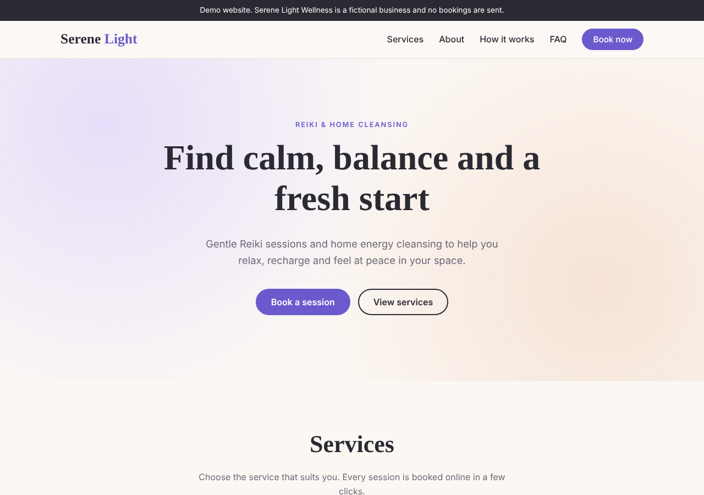

# Serene Light Wellness: booking website demo

A clean, responsive website for a **fictional** wellness business offering Reiki sessions and home cleansing, with a step-by-step online booking form.

**Live demo:** https://YOUR-USERNAME.github.io/serene-light-wellness/

## Features

- Service cards with duration and price. The "Book" buttons pre-select the service in the booking form.
- Three-step booking form: choose a service, pick a date and an available time, then enter your details
- Booked slots are greyed out, Sundays are closed, and dates are limited to the next 60 days
- Form validation with clear error messages
- Booking confirmation screen
- Mobile-friendly layout with a hamburger menu, tested on desktop, tablet and phone
- Accessible: keyboard navigation, visible focus outlines, screen-reader labels, reduced-motion support
- Safe handling of user input (typed text is never inserted as HTML)

## Built with

HTML, CSS and vanilla JavaScript. No frameworks, no build step.

## Note

This is a demo project. No bookings are sent and no personal data is stored. On a real site, the booking form would connect to a booking service such as Cal.com or Calendly, or to a WordPress booking plugin.
